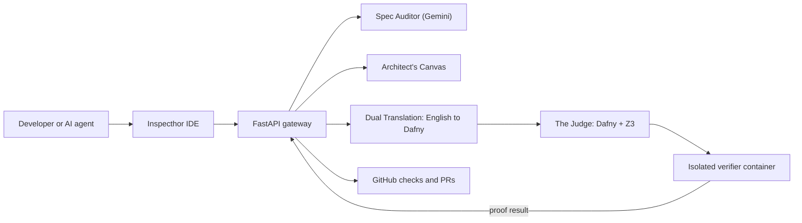

# Inspecthor

### Proof-Driven AI Security Architecture

**Bridging plain-English specifications and Dafny formal verification, with Gemini doing the reasoning.**

[](LICENSE)
[](https://www.python.org/)
[](https://fastapi.tiangolo.com/)
[](https://dafny.org/)
[](https://github.com/Z3Prover/z3)
[](https://www.docker.com/)
[](https://ai.google.dev/)
[](https://github.com/asaf-avron/inspecthor-ide-backend/actions/workflows/verify-dafny.yml)
[](https://github.com/asaf-avron/inspecthor-ide-backend/actions/workflows/quality_gate.yml)

Inspecthor is a verification gateway for AI-written code. You describe the intended behavior in plain English. Inspecthor audits that description for gaps, turns it into a Dafny contract, and uses the Dafny verifier with the Z3 solver to prove that the implementation meets the contract. If the code doesn't meet the contract, it doesn't ship.

The aim is to bring the kind of assurance used in aerospace and other safety-critical work into an ordinary pull-request workflow.

This repository is the **backend**: the API, the spec-to-proof pipeline, and the isolated verification service. The IDE is in [inspecthor-ide-frontend](https://github.com/asaf-avron/inspecthor-ide-frontend).

---

## The problem

AI coding agents such as Cursor, Devin and Copilot write code faster than anyone can review it. Much of that code is "vibe coded": it looks right, passes the happy-path test, and hides a logic error such as an off-by-one, a missing authorization check, or a state transition that should be impossible.

Human code review doesn't scale to this. Reviewers miss subtle bugs in code they wrote themselves, and miss more of them in thousands of lines an agent wrote in a minute. Tests only check the cases someone thought to write.

## The paradigm: Proof-Driven Development

Proof-Driven Development (PDD) separates **the Law** from **the Worker**:

| Source | Role | Authority | What it governs |
|--------|------|-----------|-----------------|
| **Dafny spec** | The Law | Highest (hard constraint) | Correctness, input validation, edge cases, invariants |
| **English spec** | The Guide | Medium (soft context) | Business intent, naming, readability |
| **Generated code** | The Worker | None until proven | Implementation only |

The contract is immutable. The agent that writes the code gets **read-only** access to the Dafny specification, so it can't weaken the contract to make a proof pass. The design pins each approved contract with a SHA-256 hash and locks down any run where the hash changes. That enforcement is on the [roadmap](#roadmap). See [docs/ARCHITECTURE.md](docs/ARCHITECTURE.md#5-security-architecture).

## Architecture



### Functional Core, Imperative Shell

You can only prove what you can isolate. Inspecthor keeps business logic in a **pure functional core** that has a Dafny model and is verified. I/O (HTTP, the database, GitHub, the LLM) lives in a thin **imperative shell** around it. The verified core is in [`api/core/`](api/core/) and [`core/security/crypto.py`](core/security/crypto.py). Each module has a matching `.dfy` contract in [`api/verification/`](api/verification/).

### Services

| Service | Path | Role |
|---------|------|------|
| **API** | [`api/`](api/) | FastAPI gateway on port 8000: auth, blueprints, files, spec generation, verification, GitHub App, Brain (registry and proof ledger) |
| **Core pipeline** | [`core/`](core/) | Spec Auditor, workflow and triage, Python-to-Dafny gateway, contract parser |
| **Verifier** | [`verifier/`](verifier/) | Stateless Dafny + Z3 service on an internal-only Docker network, with no credentials and no database access |
| **Database** | SQLite (default) or PostgreSQL | Users, blueprints, files, traceability links, ledger entries |

## Key features

| Feature | Status | Where |
|---------|--------|-------|
| **Spec Auditor**: finds ambiguities, missing edge cases and logic gaps in an English spec before any code is written | Available | `POST /api/generate/find-gaps`, [`core/auditor.py`](core/auditor.py) |
| **Architect's Canvas**: structured blueprint templates (Logic Model, Capabilities, Imperative Shell), so nobody starts from a blank page. A blueprint is a project backed by a GitHub repository. | Available (blueprint creation and repository scaffolding). The split-view UI is planned. | `POST /api/blueprints`, `POST /api/blueprints/initialize`, [`api/services/blueprint_genesis.py`](api/services/blueprint_genesis.py) |
| **Dual Translation**: English requirements become a Dafny contract, and code is mapped back onto that contract | Available | `POST /api/generate/spec`, [`api/verification/contract_translator.py`](api/verification/contract_translator.py) |
| **The Judge**: Dafny + Z3 proves the implementation against the contract and reports any failed proof obligations | Available | `POST /api/verify`, [`verifier/runner.py`](verifier/runner.py) |
| **Verification loop**: audit, refine, re-verify | Available with a person in the loop. The autonomous self-healing version is planned. | `POST /api/generate/refine-spec` |
| **Traceability**: links each requirement to the code and the proof that covers it | Available | `GET /api/files/{id}/traceability`, `POST /api/deconstruct` |
| **GitHub App**: webhooks and check runs that gate pull requests on verification | Available | [`api/github/`](api/github/) |
| **Brain and Proof Ledger**: a `.inspecthor/` folder per repository with a component registry (stable UUIDs) and a signed, hash-chained verification history | Beta | `/api/brain/*`, [`api/brain/`](api/brain/) |
| **Drift detection**: finds components that moved, went missing or were corrupted, and repairs the registry | Beta | `/api/drift/*`, [`api/services/drift_detector.py`](api/services/drift_detector.py) |
| **Harmonization**: keeps the English spec, the Dafny contract and the code in sync, and tracks whether a blueprint is clean or dirty | Beta | `/api/harmonize/*`, [`api/services/harmonization_service.py`](api/services/harmonization_service.py) |
| **Diagrams**: Mermaid diagrams of the intended flow (from the spec) and the actual flow (from the code), with a comparison | Beta | `/api/diagrams/*` |
| **Component refinement**: complexity report and suggestions for splitting a spec into components | Beta | `/api/refinement/*` |
| **Runtime verification**: generates tests from Dafny contracts and compares the call graph with the spec | Beta | `/api/runtime/*` |
| **Iron Grip**: branch protection and required checks for GitHub repositories | Beta | `/api/iron-grip/*`, `/api/github/iron-grip/*` |
| **TKA bootstrap**: initializes the Brain, registry and ledger for a new repository | Beta | `POST /api/tka/initialize` |

**Beta** means the feature is implemented and covered by unit tests, but it has not been exercised end to end against real GitHub installations and Gemini. The IDE leaves its Proof Ledger and Component Health tabs off by default because they don't match these endpoints yet (see the [roadmap](#roadmap)).

### Formally verified components

Inspecthor verifies its own backend. Seven Dafny specifications run in CI on every change to a `.dfy` file or to the verifier:

- **Database model**: core data structures and state invariants
- **File operations**: create, update, delete
- **Blueprint management**: creation and cascade deletion (the spec file is still named `project_management.dfy`)
- **Blueprint migration**: moving an anonymous blueprint to an authenticated user (`project_migration.dfy`)
- **Crypto contract**: Fernet encryption and decryption of tokens at rest
- **Spec generation**: partial
- **Traceability**: partial

Details are in [`docs/formally-verified/`](docs/formally-verified/), and the CI workflow is [`.github/workflows/verify-dafny.yml`](.github/workflows/verify-dafny.yml).

## Quickstart

### Prerequisites

- Docker and Docker Compose
- A Google Gemini API key ([get one here](https://aistudio.google.com/app/apikey))

You don't need to install Dafny, Z3 or .NET locally. The verifier image includes them.

### 1. Configure

```bash
git clone https://github.com/asaf-avron/inspecthor-ide-backend.git
cd inspecthor-ide-backend
cp .env.example .env
```

The minimum settings to edit in `.env`:

| Variable | Required | Purpose |
|----------|----------|---------|
| `GEMINI_API_KEY` | Yes | Spec Auditor and translation |
| `ALLOWED_API_KEYS` | Yes | Comma-separated keys accepted in the `X-API-Key` header |
| `ENCRYPTION_KEY` | Production | Fernet key for encrypting GitHub tokens at rest |
| `GITHUB_APP_ID`, `GITHUB_APP_PRIVATE_KEY_PATH`, `GITHUB_WEBHOOK_SECRET` | GitHub integration only | See [GitHub App setup](docs/instructions/GITHUB_APP_SETUP.md) |
| `GITHUB_CLIENT_ID`, `GITHUB_CLIENT_SECRET` | GitHub login only | OAuth sign-in from the IDE |

To generate an encryption key:

```bash
python -c "from cryptography.fernet import Fernet; print(Fernet.generate_key().decode())"
```

Never commit `.env`, `*.pem` or `*.db` files. They are already listed in `.gitignore`.

### 2. Run

```bash
docker-compose up --build
```

| URL | What |
|-----|------|
| http://localhost:8000 | API |
| http://localhost:8000/docs | Interactive OpenAPI docs |
| `verifier:8001` | Verifier, reachable only on the internal Docker network |

To run the API on your host while the verifier stays in Docker:

```bash
pip install -r api/requirements.txt
python -m api.main
```

Then start the [frontend](https://github.com/asaf-avron/inspecthor-ide-frontend#quickstart) on port 3000.

### 3. Test and verify

```bash
pip install pytest pytest-asyncio httpx
DATABASE_URL=sqlite:///./test.db pytest  # unit and integration tests, on SQLite
./scripts/verify_dafny.sh api/verification/models.dfy api/verification/file_operations.dfy
docker-compose exec verifier dafny verify api/verification/models.dfy
```

CI also runs `ruff` and `mypy` ([quality gate](.github/workflows/quality_gate.yml)).

## API overview

| Group | Prefix | Highlights |
|-------|--------|------------|
| Health | `/api/health` | Public liveness check |
| Generate | `/api/generate` | `spec`, `find-gaps`, `refine-spec` |
| Assistant | `/api/assistant/chat` | Gemini help for debugging failed proofs |
| Verify | `/api/verify` | Run Dafny on a contract and implementation |
| Blueprints and files | `/api/blueprints`, `/api/files` | CRUD, structure, and repository initialization |
| Traceability | `/api/deconstruct`, `/api/files/{id}/traceability` | Requirement-to-proof links |
| Auth | `/api/auth` | GitHub OAuth, refresh, logout, current user |
| GitHub | `/api/github` | Webhooks and App installations |
| Brain | `/api/brain` | Registry, proof ledger, integrity checks |
| Drift and harmonization | `/api/drift`, `/api/harmonize` | Detect and repair drift, sync spec, contract and code |
| Diagrams and refinement | `/api/diagrams`, `/api/refinement` | Mermaid diagrams, complexity analysis |
| Runtime | `/api/runtime` | Test generation, call-graph comparison |
| Iron Grip and TKA | `/api/iron-grip`, `/api/tka` | Branch protection, repository bootstrap |

The full schema is at `/docs` while the server is running.

## Repositories

| Repo | What's in it |
|------|--------------|
| [inspecthor-ide-backend](https://github.com/asaf-avron/inspecthor-ide-backend) (this repo) | FastAPI gateway, core pipeline, Dafny verifier service, verified contracts |
| [inspecthor-ide-frontend](https://github.com/asaf-avron/inspecthor-ide-frontend) | Next.js IDE: spec editor, Dafny editor, verification panel, traceability view |

## Roadmap

- [ ] **Autonomous self-healing loop**: when a proof fails, the agent repairs the code against the counterexample and re-verifies until the proof passes, without changing the contract. The stub is `auto_refine_spec` in [`core/workflow.py`](core/workflow.py).
- [ ] **Ephemeral sandboxes on Nomad**: a disposable sandbox per verification run for untrusted code, replacing today's shared verifier container.
- [ ] **Gemini 3 Pro Auditor**: move gap analysis to the newest reasoning model. Today it uses Gemini 2.0 Flash, 1.5 Flash and 1.5 Pro.
- [ ] **Architect's Canvas UI**: a split view with the blueprint on one side and proof status on the other. Spec: [Spec_Architects_Canvas_UI.md](docs/specs/Spec_Architects_Canvas_UI.md)
- [ ] **Deterministic VC generation**: verification conditions generated from the contract rather than by an LLM. Spec: [Spec_Verification_Condition_Generator.md](docs/specs/Spec_Verification_Condition_Generator.md)
- [ ] **Contract hash enforcement**: the ledger already detects when code no longer matches its last verified hash (`POST /api/brain/integrity/check`). Next is pinning each approved contract and failing the run when it changes during code generation.
- [ ] **Trust Registry**: extend the per-component proof ledger into an append-only registry of proof certificates for deployed code. Spec: [Spec_Trust_Registry.md](docs/specs/Spec_Trust_Registry.md)
- [ ] **Connect the IDE panels**: the Proof Ledger, Component Health and Harmonization components in the frontend call `/api/ledger/*`, `/api/harmonization/*` and a few `/api/drift/*` routes that the backend exposes under `/api/brain/ledger/*` and `/api/harmonize/*` (or not at all). Align the two, then turn the panels on with `NEXT_PUBLIC_ENABLE_BRAIN_UI`.
- [ ] **Domain preludes**: reusable Dafny modules for banking, healthcare and auth. Spec: [Spec_Dafny_Domain_Preludes.md](docs/specs/Spec_Dafny_Domain_Preludes.md)

The master plan is [Spec_Steel_Thread_Master.md](docs/specs/Spec_Steel_Thread_Master.md).

## Vision

Agentic engineering is changing who writes code, and review has to change with it. When an agent can produce a feature in seconds, it no longer makes sense for a person to read every line. A better use of their time is to write and approve the **contract**, and let a machine check the code against it.

Formal verification used to be too expensive for most teams because writing proofs was slow and specialized work. LLMs change that: they are good at drafting specifications and proof scaffolding, and a solver doesn't care who wrote the draft. Inspecthor is built on that combination. Gemini proposes, Dafny decides, and only proven code gets through.

## Contributing

Contributions are welcome, especially from people working on formal methods, AI agent governance or developer tooling.

1. Fork the repo and create a feature branch.
2. Keep pure logic in the functional core. If you change a verified module, update its `.dfy` contract.
3. Run `pytest`, `ruff check api/`, `mypy api/ core/`, and Dafny verification.
4. Open a pull request. CI must pass Dafny verification and the quality gate.

Use [GitHub Issues](https://github.com/asaf-avron/inspecthor-ide-backend/issues) for bugs, ideas and discussion.

## Security

See [docs/SECURITY.md](docs/SECURITY.md) for the authentication model, deployment checklist and secret handling. Please report vulnerabilities privately rather than in a public issue.

## Documentation

- [Architecture](docs/ARCHITECTURE.md): system design, PDD and security layers
- [Formally verified components](docs/formally-verified/)
- [Feature specs](docs/specs/)
- [GitHub App setup](docs/instructions/GITHUB_APP_SETUP.md) and [localhost setup](docs/instructions/GITHUB_APP_LOCALHOST_SETUP.md)
- [Documentation index](docs/README.md)

## License

[Apache License 2.0](LICENSE)
