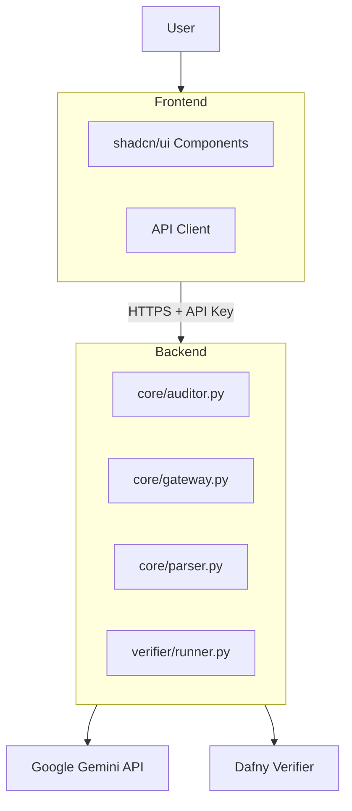

# InspecThor Architecture Documentation

> **Last Updated:** 2026-02-01  
> **Version:** 2.0 (Consolidated)

---

## 1. System Overview

InspecThor (formerly Guardian Gateway) is a formal verification IDE that transforms English requirements into verified Dafny specifications. The system is split into two services:

- **Backend**: [`inspecthor-ide-backend`](https://github.com/asaf-avron/inspecthor-ide-backend) - Python FastAPI server with core verification logic
- **Frontend**: [`inspecthor-ide-frontend`](https://github.com/asaf-avron/inspecthor-ide-frontend) - Next.js web application with modern IDE interface



---

## 2. Core Philosophy: Proof-Driven Development (PDD)

We invert the typical development pyramid. Instead of writing code then testing, we write the **Specification** and **Refine** it into code.

### Hierarchy of Truth

| Source | Role | Authority | Function |
|--------|------|-----------|----------|
| **Dafny Spec** | The Law | Highest (Hard Constraint) | Correctness, input validation, edge cases |
| **English Spec** | The Guide | Medium (Soft Context) | Variable naming, readability, business intent |

---

## 3. Backend Components

### Core Modules

| Module | Location | Purpose |
|--------|----------|---------|
| **Spec Auditor** | `core/auditor.py` | LLM-powered gap detection, Dafny skeleton generation |
| **Code Gateway** | `core/gateway.py` | Python→Dafny transpilation via Gemini |
| **Parser** | `core/parser.py` | Input format parsing |
| **Workflow** | `core/workflow.py` | Pipeline orchestration |
| **Dafny Runner** | `verifier/runner.py` | Dafny CLI execution with Z3 solver |

### API Layer

| Endpoint | Method | Purpose |
|----------|--------|---------|
| `/api/health` | GET | Health check (public) |
| `/api/generate/spec` | POST | Generate Dafny from English |
| `/api/generate/find-gaps` | POST | Find gaps without code gen |
| `/api/generate/refine-spec` | POST | Apply gap suggestions |
| `/api/verify` | POST | Run Dafny verification |
| `/api/files/*` | CRUD | File management |
| `/api/projects/*` | CRUD | Project management |

### Database Schema

Key tables: `users`, `projects`, `files`, `spec_dafny_links`, `unit_links`, `anchors`, `proof_receipts`

---

## 4. Frontend Components

### IDE Layout

| Component | Location | Purpose |
|-----------|----------|---------|
| **Project Explorer** | `components/ide/project-explorer.tsx` | File tree navigation |
| **Markdown Editor** | `components/ide/markdown-editor.tsx` | Requirements authoring |
| **Code Editor** | `components/ide/code-editor.tsx` | Dafny code viewing |
| **Verification Panel** | `components/ide/verification-panel.tsx` | Proof obligations |
| **Traceability View** | `components/ide/traceability-view.tsx` | Spec↔Code mapping |
| **Gemini Panel** | `components/ide/gemini-insight-panel.tsx` | AI assistant |

---

## 5. Security Architecture

### The Immutable Contract Policy

**Golden Rule:** The AI Agent responsible for writing code must have **READ-ONLY** access to the Dafny Specification. It must **NEVER** modify it.

### Cryptographic Enforcement

1. **Phase 1 (Design):** Spec Auditor generates `interface.dfy`, system calculates SHA256 hash (Hash_A)
2. **Phase 2 (Build):** Coder Agent writes `implementation.py`
3. **Phase 3 (Verify):** Guardian re-calculates hash (Hash_B)
   - If `Hash_A != Hash_B`: **SECURITY LOCKDOWN** - Agent tampered with contract

### Security Layers

| Layer | Implementation |
|-------|----------------|
| HTTPS/TLS | All production traffic encrypted |
| API Key Auth | `X-API-Key` header required |
| CORS | Whitelist of allowed origins |
| Rate Limiting | Per-IP request limits |
| Request Logging | Audit trail of all API calls |

---

## 6. Production Vision

### Three Pillars

1. **Spec Studio** - Collaborative web dashboard for architects
2. **Guardian Bot** - GitHub/GitLab CI/CD gatekeeper
3. **Trust Registry** - Immutable ledger of verified deployments

### The Invisible Workflow

```
Define → Code → Verify → Deploy
```

Only signed, verified artifacts reach production.

---

## 7. Technology Stack

### Backend
- **Framework:** FastAPI (Python 3.13 in Docker)
- **AI:** Google Gemini API
- **Verification:** Dafny CLI with Z3 solver
- **Database:** SQLite by default, PostgreSQL optional, with SQLAlchemy ORM
- **Server:** Uvicorn (ASGI)

### Frontend
- **Framework:** Next.js 16 (React 19)
- **Language:** TypeScript
- **UI:** shadcn/ui (Radix UI + Tailwind CSS)
- **State:** React Context + hooks

---

## 8. Gap Analysis Reference

For the tactical roadmap, see the [master spec](specs/Spec_Steel_Thread_Master.md) and the [README roadmap](../README.md#roadmap).

Key findings:
- 49+ files use "Project" nomenclature (should be "Blueprint")
- Verification is probabilistic (LLM-based), not deterministic
- Trust Registry schema exists but lacks immutability
- UI needs Blueprint/Proof split-view canvas

---

## Appendix: Specification Template

### Feature Specification Structure

```markdown
# [Feature Name] Specification

## 1. Logic Model (State)
- **Entities:** [e.g., User, Wallet]
- **Variables:** [e.g., User.Balance: Integer]
- **Invariants:** [What must NEVER be false?]

## 2. Capabilities (Functional Core)
### Function: [Name]
- **Inputs:** [Name: Type]
- **Preconditions:** [What must be true BEFORE?]
- **Postconditions:** [What is guaranteed AFTER?]
- **Edge Cases:** [Special handling]

## 3. Imperative Shell (Unverified I/O)
- **Reads:** [External data sources]
- **Writes:** [External state changes]
- **Side Effects:** [Notifications, logs]
```
