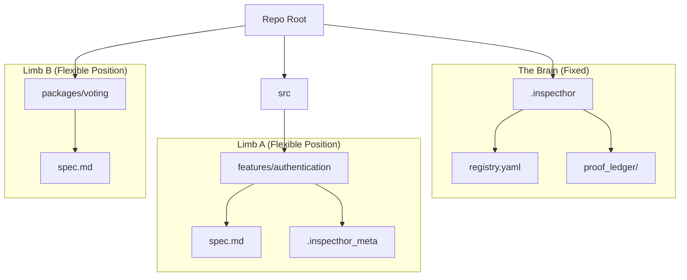

# Repository Architecture: "Brain & Limbs" (Fractal Control)

To balance the "Nuclear Option" of correctness with the flexibility required by modern development, we adopt a **Fractal Control** architecture. InspecThor does not insist on owning the entire repository layout; instead, it owns **Domains (Blueprints)** wherever they reside.

## The Metaphor: Brain & Limbs

### 1. The Brain: `.inspecthor/`
**The Embassy.** This is the only fixed point in the repository.
- **Location**: Repository Root.
- **Role**:
    - **Registry (`registry.yaml`)**: Maps Component UUIDs to their last known paths.
    - **Ledger (`proof_ledger/`)**: Stores cryptographic hashes of verification states.
    - **Keys**: Public keys for verification.

### 2. The Limbs: Blueprints
**The Workspaces.** These can be placed *anywhere* (e.g., `src/features/`, `packages/`, `lib/`).
- **Identity over Path**: Each Blueprint contains a hidden `.inspecthor_meta` file containing a UUID.
- **Structure**:
    - `spec.md`: The User Interface.
    - `core.dfy`: The System Truth.
    - `generated/`: The Compiled Artifacts.

## Handling Structural Drift

We allow users to refactor their codebase (move folders) without breaking InspecThor.

### Scenario A: Refactoring (Moving a Limb)
*User moves `src/auth` to `src/legacy/auth`.*
1.  **Detection**: InspecThor checks `registry.yaml` -> `src/auth`. **MISSING**.
2.  **Scan**: InspecThor scans the repo for the UUID found in `.inspecthor_meta`.
3.  **Update**: Registry is updated: `UUID: auth-123 -> src/legacy/auth`.
4.  **Result**: Seamless continuity.

### Scenario B: Tampering (Touching the Internals)
*User edits `src/auth/core.dfy` manually.*
1.  **Verification**: InspecThor checks the hash of `core.dfy` against the `proof_ledger`.
2.  **Detect**: Mismatch. State is **CORRUPTED**.
3.  **Action**: InspecThor rejects the change. It offers to **"Repair"** (regenerate `core.dfy` from `spec.md`), enforcing the one-way flow.

## Conclusion
This architecture allows InspecThor to integrate into *any* existing project structure (Monorepo, Django, React, etc.) while maintaining absolute control over the correctness of the components it manages.
