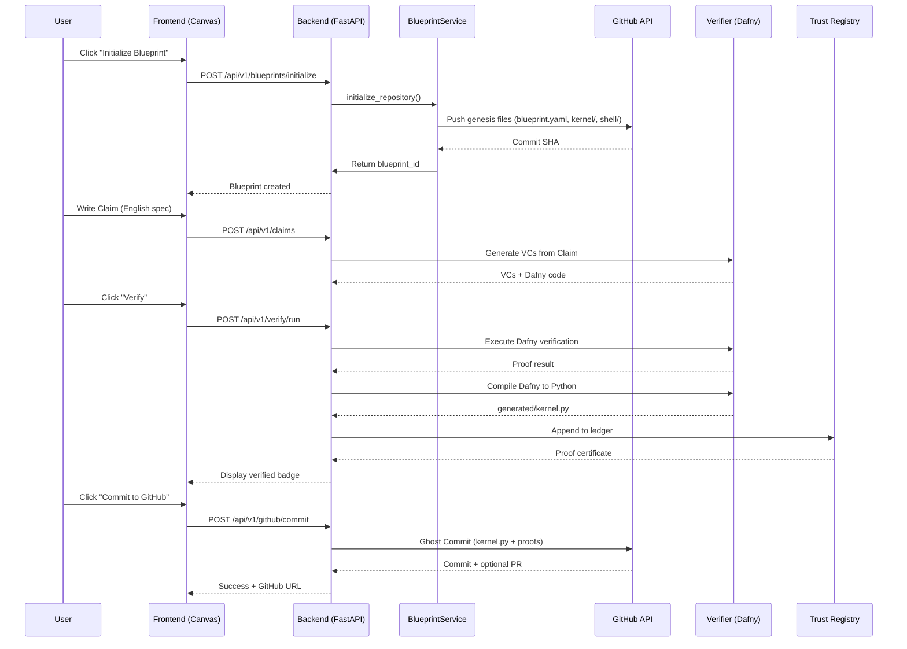
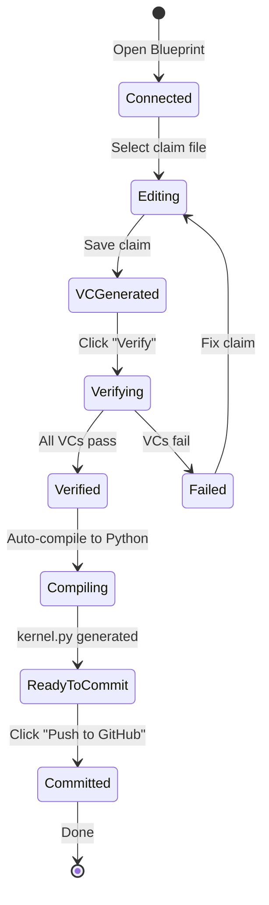
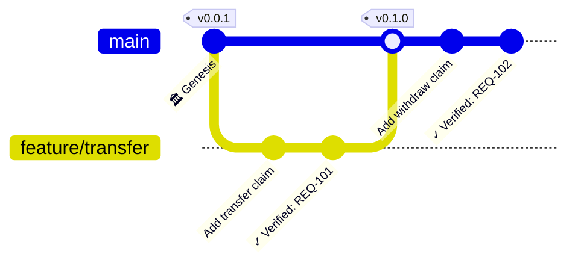

# Steel Thread Master Specification

> **Priority:** P0 - MASTER SPEC - Takes precedence over all other specs  
> **Version:** 1.0  
> **Last Updated:** 2026-02-01  
> **Status:** ACTIVE

---

## 0. Executive Summary

This specification defines the **Steel Thread**: a single, unbroken execution path from user action to verified result. All other specifications are subordinate to this document.

**The Principle:** Correctness by Construction. The system enforces architecture, not humans.

---

## 1. The End-to-End Flow



---

## 2. The Trusted Kernel Architecture

Every InspecThor-managed repository must follow this structure. The system enforces this, not the user.

### 2.1 Repository Layout

```
repository/
├── blueprint.yaml          # THE LAW - Immutable manifest
├── claims/                  # Human-written specifications
│   └── *.md                 # Structured English claims
├── kernel/                  # Formally Verified Zone (Dafny only)
│   ├── Main.dfy             # Entry point - all logic here
│   ├── Prelude.dfy          # Domain types + invariants
│   └── *.dfy                # Additional modules
├── shell/                   # Unverified Zone (I/O only)
│   ├── main.py              # Entry point - imports generated/kernel.py
│   └── adapters/            # External integrations
├── generated/               # AUTO-GENERATED - Never edit
│   ├── kernel.py            # Python compiled from kernel/*.dfy
│   ├── contracts.dfy        # VCs from claims
│   └── proofs/              # Proof certificates
└── .inspecthor/             # System metadata
    └── config.yaml          # Local settings
```

### 2.2 The Manifest (blueprint.yaml)

```yaml
# blueprint.yaml - THE LAW
version: "1.0"
name: "Payment Processing System"
domain: "banking"  # banking | healthcare | authentication | custom

invariants:
  - "Balance can never be negative"
  - "Total system money is conserved"

claims:
  - path: "claims/transfer.md"
    id: "REQ-101"
    status: "verified"  # unverified | verified | failed

kernel:
  entry: "kernel/Main.dfy"
  prelude: "preludes/banking"  # From InspecThor prelude library

shell:
  entry: "shell/main.py"
  runtime: "python3.11"

verification:
  solver: "z3"
  timeout_seconds: 120
  last_verified: "2026-02-01T10:00:00Z"
  proof_certificate: "generated/proofs/latest.json"
```

### 2.3 The Genesis Event

When a user initializes a Blueprint, InspecThor pushes the following files:

```python
GENESIS_FILES = {
    "blueprint.yaml": """version: "1.0"
name: "{blueprint_name}"
domain: "custom"
invariants: []
claims: []
kernel:
  entry: "kernel/Main.dfy"
shell:
  entry: "shell/main.py"
verification:
  solver: "z3"
  timeout_seconds: 120
""",
    "kernel/Main.dfy": """// InspecThor Kernel - Formally Verified Zone
module Kernel {
    // All business logic goes here
    // This code is verified by Dafny
    
    method Init() 
        ensures true  // Replace with actual postconditions
    {
        // Entry point
    }
}
""",
    "shell/main.py": """#!/usr/bin/env python3
\"\"\"
InspecThor Shell - Unverified I/O Zone

This layer handles:
- HTTP requests/responses
- Database operations  
- External API calls
- File I/O

It MUST NOT contain business logic.
Business logic belongs in kernel/
\"\"\"

if __name__ == "__main__":
    # Import and call kernel methods via FFI bridge
    pass
""",
    "claims/.gitkeep": "",
    "generated/.gitkeep": "",
    ".inspecthor/config.yaml": """# Local configuration
cache_enabled: true
auto_verify: false
""",
    ".github/workflows/verify.yml": """# InspecThor Verification Pipeline
# Auto-generated - ensures all PRs are formally verified

name: InspecThor Verify

on:
  push:
    branches: [main]
    paths:
      - 'kernel/**'
      - 'claims/**'
  pull_request:
    branches: [main]
    paths:
      - 'kernel/**'
      - 'claims/**'

jobs:
  verify:
    runs-on: ubuntu-latest
    steps:
      - uses: actions/checkout@v4
      
      - name: Install Dafny
        run: |
          wget https://github.com/dafny-lang/dafny/releases/download/v4.4.0/dafny-4.4.0-x64-ubuntu-20.04.zip
          unzip dafny-4.4.0-x64-ubuntu-20.04.zip -d /opt/dafny
          echo "/opt/dafny/dafny" >> $GITHUB_PATH
      
      - name: Verify Kernel
        run: dafny verify kernel/Main.dfy
      
      - name: Compile to Python
        run: dafny build --target:py kernel/Main.dfy -o generated/kernel
      
      - name: Upload Artifacts
        uses: actions/upload-artifact@v4
        with:
          name: verified-kernel
          path: generated/kernel.py
"""
}

---

## 2.4 Post-Genesis Workflow (Day 2+)

Once the repository is initialized, the development loop begins:

### In the IDE (InspecThor Canvas)



**IDE Behavior:**

| Event | IDE Action |
|-------|------------|
| User opens Blueprint | Sync `blueprint.yaml` from repo |
| User edits `claims/*.md` | Auto-save locally, show VC preview |
| User clicks "Verify" | Call backend API, show live progress |
| Verification passes | Auto-compile Dafny → Python |
| User clicks "Push" | Ghost Commit: kernel.py + proof.json |
| PR is created | Show GitHub link, track CI status |

### In the Git Repository



**Git Workflow:**

1. **Genesis commit** creates base structure
2. **Feature branches** for new claims
3. **Verified commits** include proof certificates
4. **PRs blocked** until verification passes (via GitHub Actions)
5. **Main branch** always contains verified code

### GitHub Actions Enforcement

The genesis push includes `.github/workflows/verify.yml`:

```yaml
# .github/workflows/verify.yml (pushed during genesis)
name: InspecThor Verify

on:
  pull_request:
    branches: [main]
    paths:
      - 'kernel/**'
      - 'claims/**'

jobs:
  verify:
    runs-on: ubuntu-latest
    steps:
      - uses: actions/checkout@v4
      
      - name: Install Dafny
        run: |
          wget https://github.com/dafny-lang/dafny/releases/download/v4.4.0/dafny-4.4.0-x64-ubuntu-20.04.zip
          unzip dafny-4.4.0-x64-ubuntu-20.04.zip -d /opt/dafny
          echo "/opt/dafny/dafny" >> $GITHUB_PATH
      
      - name: Verify Kernel
        run: dafny verify kernel/Main.dfy
        
      - name: Compile to Python
        run: dafny build --target:py kernel/Main.dfy -o generated/kernel
```

**Enforcement:**

- GitHub branch protection rules require this check to pass
- PRs cannot merge without green verification status
- The CI is **independent** of InspecThor backend (runs in GitHub's infra)
- Even if someone bypasses the IDE, the repo still enforces verification

### Two-Layer Protection

| Layer | Enforcement Point | Bypassed By |
|-------|-------------------|-------------|
| **IDE** | "Push" button requires verification | Direct git push |
| **GitHub Actions** | PR merge requires CI pass | Admin override only |

**The Guarantee:** Even if someone pushes directly via `git push`, the GitHub Action blocks merging until verification passes.

---

## 3. Implementation Strategy: Phased Approach

### Phase 0: Steel Thread MVP (THIS SPRINT)
**Goal:** One complete flow from UI to GitHub commit with verification.

| Component | Action | Status |
|-----------|--------|--------|
| `BlueprintService.initialize_repository()` | Implement genesis push | TO DO |
| UI: "Initialize Blueprint" button | Add to header | TO DO |
| API: `POST /api/v1/blueprints/initialize` | New endpoint | TO DO |
| Verification: Run existing Dafny flow | Already works | DONE |
| Trust: Store result in `proof_receipts` | Already works | DONE |
| Commit: Use `GhostCommitService` | Already implemented | DONE |

### Phase 1: Foundation (From existing spec)
- Rename Project → Blueprint (clean break, no backward compat)
- Database migration (drop old tables after migration)

### Phase 2: The Bridge (From existing spec)
- VC Generator (deterministic, not LLM)
- Claim Parser
- Enhanced Dafny integration

### Phase 3: The Ledger (From existing spec)
- Trust Registry with chain integrity
- Proof certificates
- Immutability enforcement

---

## 4. API Contracts

### 4.1 Initialize Blueprint Repository

**Endpoint:** `POST /api/v1/blueprints/initialize`

**Request:**
```json
{
    "name": "Payment Processing",
    "repository_url": "https://github.com/user/repo",
    "installation_id": 12345,
    "domain": "banking",
    "initial_claim": "optional English spec"
}
```

**Response:**
```json
{
    "blueprint_id": "uuid",
    "repository_url": "https://github.com/user/repo",
    "commit_sha": "abc123...",
    "commit_url": "https://github.com/user/repo/commit/abc123",
    "files_created": [
        "blueprint.yaml",
        "kernel/Main.dfy",
        "shell/main.py"
    ],
    "next_steps": [
        "Add a claim in claims/ directory",
        "Run verification to generate contracts"
    ]
}
```

### 4.2 Create Claim

**Endpoint:** `POST /api/v1/blueprints/{id}/claims`

**Request:**
```json
{
    "claim_id": "REQ-101",
    "title": "Transfer Funds",
    "content": "## Preconditions\n- Balance >= amount\n\n## Postconditions\n- Sender balance decreases"
}
```

### 4.3 Verify and Commit

**Endpoint:** `POST /api/v1/blueprints/{id}/verify-and-commit`

**Request:**
```json
{
    "claims": ["REQ-101", "REQ-102"],
    "commit_message": "Verified transfer logic"
}
```

**Response:**
```json
{
    "verification": {
        "passed": true,
        "vcs_total": 4,
        "vcs_discharged": 4,
        "proof_certificate_id": "uuid"
    },
    "commit": {
        "sha": "def456...",
        "url": "https://github.com/user/repo/commit/def456"
    }
}
```

---

## 5. Implementation Files

### New Files (Phase 0)

| File | Purpose |
|------|---------|
| `api/services/blueprint_genesis.py` | Genesis event implementation |
| `api/endpoints/blueprints_v1.py` | New v1 API endpoints |
| `assets/genesis/` | Template files for repository init |

### Modified Files (Phase 0)

| File | Changes |
|------|---------|
| `api/services/project_service.py` | Add `initialize_repository()` method |
| `api/main.py` | Add v1 blueprints router |
| Frontend: `header.tsx` | Add "Initialize Blueprint" button |
| Frontend: Add `BlueprintInitModal` | Repository selection UI |

---

## 6. Extension Points (Future-Proofing)

### 6.1 Prelude Library
- Domain preludes stored in `assets/preludes/`
- Referenced by `blueprint.yaml#kernel.prelude`
- Genesis can inject appropriate prelude based on domain

### 6.2 Multi-Language Kernel
- Currently: Dafny only
- Future: Could support Coq, Lean, Z3 SMT-LIB
- Abstraction: `VerificationEngine` interface

### 6.3 CI/CD Integration
- GitHub Actions workflow generated in genesis
- Webhook triggers verification on PR
- Block merge if verification fails

### 6.4 Proof Certificate Format
- Currently: JSON stored in DB
- Future: W3C Verifiable Credentials format
- Blockchain anchoring (optional enterprise feature)

---

## 7. Error Handling

### 7.1 Genesis Failures

| Error | Handling |
|-------|----------|
| Repo not empty | Warn user, offer to overwrite or abort |
| No installation token | Prompt to install GitHub App |
| Permission denied | Check app permissions |
| Network failure | Retry with backoff |

### 7.2 Verification Failures

| Error | Handling |
|-------|----------|
| Dafny timeout | Suggest simplifying claim |
| Z3 memory limit | Increase limits or split claims |
| Syntax error in VC | Show line number, offer fix suggestions |

---

## 8. Dafny to Python Compilation

### The Compilation Step

After verification passes, Dafny compiles the kernel to Python:

```bash
# Verify first
dafny verify kernel/Main.dfy

# Then compile to Python
dafny build --target:py kernel/Main.dfy -o generated/kernel
```

**Output:** `generated/kernel.py` - A Python module with verified logic.

### Shell Integration

The shell layer imports the generated kernel:

```python
# shell/main.py
from generated.kernel import Kernel

class PaymentService:
    def __init__(self):
        self.kernel = Kernel()
    
    def transfer(self, from_id: str, to_id: str, amount: float):
        # I/O: Load from database
        sender = self.db.get_account(from_id)
        receiver = self.db.get_account(to_id)
        
        # VERIFIED LOGIC: Call kernel
        result = self.kernel.Transfer(sender, receiver, amount)
        
        # I/O: Save to database
        self.db.save_accounts([sender, receiver])
        return result
```

### Key Principle

- **kernel/*.dfy** → Business logic (formally verified)
- **generated/kernel.py** → Compiled output (never edit)
- **shell/main.py** → I/O wrapper (imports kernel)

---

## 9. Success Criteria (Phase 0)

- [ ] User can click "Initialize Blueprint" in UI
- [ ] System pushes genesis files to empty GitHub repo
- [ ] User sees commit appear in GitHub within 5 seconds
- [ ] User can add a claim in the IDE
- [ ] System generates VCs from claim
- [ ] User can run verification
- [ ] System stores proof in database
- [ ] User can commit verified code to GitHub
- [ ] Complete flow takes < 60 seconds

---

## 10. Non-Goals (Phase 0)

- ❌ Rename Project → Blueprint (Phase 1)
- ❌ Deterministic VC generator (Phase 2)
- ❌ Immutable Trust Registry (Phase 3)
- ❌ UI Canvas redesign (Phase 2-3)
- ❌ Multi-repo support
- ❌ Team collaboration features

---

## Appendix A: Existing Infrastructure Audit

### What We Have (Ready to Use)

| Component | Location | Status |
|-----------|----------|--------|
| GitHub App integration | `api/github/` | ✅ Complete |
| Tree/commit creation | `api/github/api_client.py` | ✅ Complete |
| Ghost commit service | `api/github/commits.py` | ✅ Complete |
| Dafny verification | `verifier/runner.py` | ✅ Complete |
| Proof receipt storage | `api/database.py` | ✅ Complete |
| Project CRUD | `api/services/project_service.py` | ✅ Complete |
| File CRUD | `api/files.py` | ✅ Complete |

### What We Need to Build

| Component | Description | Effort |
|-----------|-------------|--------|
| Genesis push logic | Use existing `create_tree()`, `create_commit()` | 2-3 hours |
| Blueprint init endpoint | New FastAPI route | 1 hour |
| UI init button | Frontend modal + API call | 2-3 hours |
| Template files | YAML + Dafny stubs | 1 hour |

**Total Phase 0 Effort:** ~1 day of focused work

---

## Appendix B: Commands Reference

### Local Development

```bash
# Start backend
cd inspecthor-ide-backend
uvicorn api.main:app --reload --port 8000

# Start frontend
cd inspecthor-ide-frontend
pnpm dev

# Test genesis locally (after implementation)
curl -X POST http://localhost:8000/api/v1/blueprints/initialize \
  -H "Content-Type: application/json" \
  -H "X-API-Key: your-key" \
  -d '{"name": "test", "repository_url": "https://github.com/user/test-repo", "installation_id": 12345}'
```

---

## Version History

| Version | Date | Changes |
|---------|------|---------|
| 1.0 | 2026-02-01 | Initial Steel Thread specification |
| 1.1 | 2026-02-01 | Added post-genesis workflow, GitHub Actions, Python compilation |
| 1.2 | 2026-02-01 | Added implementation checklist, cleanup strategy, testing plan |

---

## Appendix C: Implementation Checklist

### Backend Tasks

| # | Task | File | Effort |
|---|------|------|--------|
| B1 | Create `BlueprintGenesisService` | `api/services/blueprint_genesis.py` (NEW) | 2h |
| B2 | Create `/api/v1/blueprints/initialize` endpoint | `api/endpoints/blueprints.py` (NEW) | 1h |
| B3 | Register router in main.py | `api/main.py` (MODIFY) | 15m |
| B4 | Create genesis template files | `assets/genesis/` (NEW) | 30m |
| B5 | Write backend tests | `tests/test_blueprint_genesis.py` (NEW) | 1h |

### Frontend Tasks

| # | Task | File | Effort |
|---|------|------|--------|
| F1 | Add "Initialize Blueprint" button | `components/ide/header.tsx` (MODIFY) | 30m |
| F2 | Create BlueprintInitModal | `components/blueprint/init-modal.tsx` (NEW) | 2h |
| F3 | Add API client method | `lib/api-client.ts` (MODIFY) | 30m |
| F4 | Write frontend tests | `__tests__/blueprint-init.test.tsx` (NEW) | 1h |

### Integration Tasks

| # | Task | Description | Effort |
|---|------|-------------|--------|
| I1 | E2E test: steel thread flow | Init → Edit → Verify → Push | 2h |
| I2 | Manual QA with real GitHub repo | Verify genesis + CI runs | 1h |

**Total: ~12 hours**

---

## Appendix D: Cleanup Strategy

### Phase 1 Backend Cleanup

| File | Action |
|------|--------|
| `api/projects.py` | DELETE (replaced by blueprints) |
| `api/services/project_service.py` | RENAME → `blueprint_service.py` |
| `core/gateway.py` LLM transpilation | REMOVE (replaced by VC generator) |
| All `project_id` references | RENAME → `blueprint_id` |

### Phase 1 Frontend Cleanup

| File | Action |
|------|--------|
| `lib/project-context.tsx` | RENAME → `blueprint-context.tsx` |
| `components/ide/project-explorer.tsx` | RENAME → `blueprint-navigator.tsx` |
| All `projectId` props/params | RENAME → `blueprintId` |

### Database Cleanup

```sql
-- Run AFTER migration verification
ALTER TABLE projects RENAME TO blueprints;
ALTER TABLE blueprints RENAME COLUMN project_id TO blueprint_id;
-- Update all FK references
```

---

## Appendix E: Testing Plan

### Unit Tests (Backend)

```python
# tests/test_blueprint_genesis.py
def test_genesis_creates_all_files(): ...
def test_genesis_includes_github_action(): ...
def test_genesis_fails_on_non_empty_repo(): ...
def test_genesis_returns_commit_sha(): ...
```

### Unit Tests (Frontend)

```typescript
// __tests__/blueprint-init.test.tsx
test('shows repo selector')
test('calls API on submit')
test('shows success with GitHub link')
test('handles API errors')
```

### E2E Test

```typescript
// e2e/steel-thread.spec.ts
test('complete flow: init → edit → verify → push', async () => {
  // 1. Click "Initialize Blueprint"
  // 2. Select test repo
  // 3. Verify genesis commit in GitHub
  // 4. Add claim file
  // 5. Run verification
  // 6. Push to GitHub
  // 7. Verify GitHub Action runs
});
```
