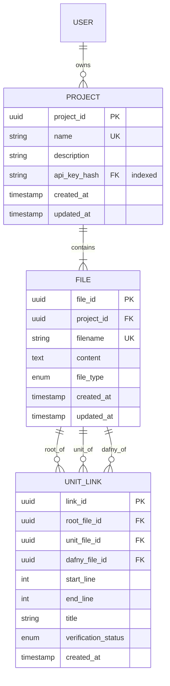

# Feature Spec: Project Management System

## 1. The Logic Model

A project management system that enables users to create, organize, and manage formal verification projects with strict ownership isolation and URL-based state recovery.

**Constraint:** Project context must be persistable via URL (e.g., `/app/:project_id`) to ensure state recovery on page refresh.

### Dependencies
- **Database:** PostgreSQL with SQLAlchemy ORM
- **Authentication:** API Key middleware (hashed with SHA-256)
- **Routing:** Next.js App Router (URL-driven state)
- **Security:** API Key ownership isolation (no cross-user access)

### Definitions
- **Project:** A container for related specification files, Dafny code, and verification artifacts
- **Project ID:** UUID v4 identifier unique per project
- **API Key Hash:** SHA-256 hash of user's API key (for ownership scoping)
- **Project Ownership:** Projects are scoped to API keys; users can only access their own projects
- **Bootstrap:** Automatic creation of initial files when project is created

### State Space
```python
project_id: UUID (primary key)
project_name: String (1-255 chars, unique per API key)
project_description: String | null (max 1000 chars)
created_at: DateTime (auto-set on creation)
updated_at: DateTime (auto-set on update)
api_key_hash: String (SHA-256, 64 chars, indexed)
file_count: Integer (derived from count of related files)
```

### Database Schema

```sql
-- Projects Table
CREATE TABLE projects (
    project_id UUID PRIMARY KEY DEFAULT gen_random_uuid(),
    name VARCHAR(255) NOT NULL,
    description TEXT,
    api_key_hash VARCHAR(64) NOT NULL,
    created_at TIMESTAMP NOT NULL DEFAULT CURRENT_TIMESTAMP,
    updated_at TIMESTAMP NOT NULL DEFAULT CURRENT_TIMESTAMP,
    
    -- Indexes for performance
    INDEX idx_api_key_hash (api_key_hash),
    INDEX idx_updated_at (updated_at),
    
    -- Unique constraint: name is unique per API key
    UNIQUE (api_key_hash, LOWER(name))
);

-- Files Table (related to projects)
CREATE TABLE files (
    file_id UUID PRIMARY KEY DEFAULT gen_random_uuid(),
    project_id UUID NOT NULL,
    filename VARCHAR(255) NOT NULL,
    content TEXT NOT NULL,
    file_type VARCHAR(10) NOT NULL CHECK (file_type IN ('md', 'dfy', 'unit')),
    created_at TIMESTAMP NOT NULL DEFAULT CURRENT_TIMESTAMP,
    updated_at TIMESTAMP NOT NULL DEFAULT CURRENT_TIMESTAMP,
    
    -- Foreign key with cascade delete
    FOREIGN KEY (project_id) REFERENCES projects(project_id) ON DELETE CASCADE,
    
    -- Unique constraint: filename is unique per project
    UNIQUE (project_id, filename)
);

-- Unit Links Table (for deconstruction feature)
CREATE TABLE unit_links (
    link_id UUID PRIMARY KEY DEFAULT gen_random_uuid(),
    root_file_id UUID NOT NULL,
    unit_file_id UUID NOT NULL,
    dafny_file_id UUID NOT NULL,
    start_line INTEGER NOT NULL,
    end_line INTEGER NOT NULL,
    title VARCHAR(255),
    verification_status VARCHAR(20) DEFAULT 'unknown',
    created_at TIMESTAMP NOT NULL DEFAULT CURRENT_TIMESTAMP,
    
    -- Foreign keys with cascade delete
    FOREIGN KEY (root_file_id) REFERENCES files(file_id) ON DELETE CASCADE,
    FOREIGN KEY (unit_file_id) REFERENCES files(file_id) ON DELETE CASCADE,
    FOREIGN KEY (dafny_file_id) REFERENCES files(file_id) ON DELETE CASCADE
);
```

### ERD Diagram



---

## 2. Capabilities

### Capability 2.1: Create Project & Bootstrap

**Goal:** Create a new project and immediately return context for routing.

**Input:**
```python
class ProjectCreateRequest(BaseModel):
    name: str = Field(..., min_length=1, max_length=255)
    description: Optional[str] = Field(None, max_length=1000)
```

**Logic:**
1. Extract API key from request header (middleware ensures valid)
2. Hash API key with SHA-256 → `api_key_hash`
3. Validate name is unique per `api_key_hash` (case-insensitive)
4. Create Project record in DB with auto-generated UUID
5. **Bootstrap:** Automatically create a `README.md` file:
   ```markdown
   # {project_name}
   
   {description if provided}
   
   Project created on {created_at}
   ```
6. Return project details with redirect URL

**Validation:**
- ✅ name: non-empty, 1-255 characters
- ✅ name: unique per API key (case-insensitive: LOWER(name))
- ✅ description: optional, max 1000 characters
- ✅ API key: valid (middleware handles this)

**Decision Tree:**
```
IF name is empty OR name > 255 chars:
    RETURN 400 Bad Request {"error": "Invalid name length"}

IF name already exists for this API key (case-insensitive):
    RETURN 400 Bad Request {"error": "Project name already exists"}

IF all validations pass:
    CREATE project
    CREATE README.md file
    RETURN 201 Created with project details
```

**Result:**
```python
class ProjectResponse(BaseModel):
    project_id: str  # UUID
    name: str
    description: Optional[str]
    created_at: str  # ISO 8601
    updated_at: str  # ISO 8601
    file_count: int
    redirect_url: str  # "/app/{project_id}"
```

**Postconditions:**
1. ✅ Project exists in database
2. ✅ Project has exactly 1 file (README.md)
3. ✅ Project is owned by requesting API key
4. ✅ Frontend can immediately redirect to `/app/{project_id}`
5. ✅ Name is unique per API key (case-insensitive)

**SQL Implementation Example:**
```python
# In api/projects.py
from sqlalchemy import func

async def create_project(request: ProjectCreateRequest, api_key_hash: str):
    # Check for existing project (case-insensitive)
    existing = db.query(Project).filter(
        Project.api_key_hash == api_key_hash,
        func.lower(Project.name) == request.name.lower()
    ).first()
    
    if existing:
        raise HTTPException(400, "Project name already exists")
    
    # Create project
    project = Project(
        name=request.name,
        description=request.description,
        api_key_hash=api_key_hash
    )
    db.add(project)
    db.flush()  # Get project_id before creating file
    
    # Bootstrap README
    readme = File(
        project_id=project.project_id,
        filename="README.md",
        content=f"# {project.name}\n\n{project.description or ''}\n\nProject created on {project.created_at}",
        file_type="md"
    )
    db.add(readme)
    db.commit()
    
    return ProjectResponse(
        project_id=str(project.project_id),
        name=project.name,
        description=project.description,
        created_at=project.created_at.isoformat(),
        updated_at=project.updated_at.isoformat(),
        file_count=1,
        redirect_url=f"/app/{project.project_id}"
    )
```

---

### Capability 2.2: Context Switching (Frontend)

**Goal:** Switch projects without retaining stale state.

**Input:**
- User clicks Project in Sidebar
- New project ID from click event

**Logic:**
```typescript
// In lib/project-context.tsx
const switchProject = async (newProjectId: string) => {
  // 1. Check if switching to same project
  if (currentProjectId === newProjectId) return;
  
  // 2. Save current file if dirty (see File Operations spec)
  if (currentFile && saveState === "dirty") {
    await forceSave(currentFile);
  }
  
  // 3. Navigate to new project URL
  router.push(`/app/${newProjectId}`);
  
  // 4. Reset state (useEffect will detect URL change)
  resetState();
  
  // 5. Fetch new project structure
  try {
    const structure = await apiClient.getProjectStructure(newProjectId);
    setProject(structure.project);
    setFiles(structure.files);
  } catch (error) {
    if (error.status === 404 || error.status === 403) {
      // Project not found or unauthorized
      router.push('/dashboard');
      toast.error("Project not found or unauthorized");
    } else {
      toast.error("Failed to load project");
    }
  }
};

const resetState = () => {
  setSelectedFileId(null);
  setMarkdownContent("");
  setDafnyCode("");
  setFileCache({});
  setSaveState("saved");
  setVerificationResults(null);
};
```

**Validation:**
- ✅ Project ID must be valid UUID format
- ✅ Project must exist and be owned by API key
- ✅ Current file must be saved before switching

**Decision Tree:**
```
IF project_id === current_project_id:
    RETURN (no action needed)

IF current_file is dirty:
    TRIGGER force save
    WAIT for save completion

NAVIGATE to /app/{new_project_id}

TRY fetch project structure:
    IF 404 or 403:
        REDIRECT to /dashboard
        SHOW error toast
    IF other error:
        SHOW error toast
        ALLOW retry

IF successful:
    UPDATE context with new project
    RENDER file tree
```

**Result:**
- Project context is loaded
- File tree is populated
- No stale state from previous project
- URL reflects current project

**Postconditions:**
1. ✅ All previous project state is cleared
2. ✅ New project context is loaded
3. ✅ File tree reflects new project
4. ✅ URL is `/app/{new_project_id}`
5. ✅ No dirty files remain from previous project

---

### Capability 2.3: List Projects

**Goal:** Retrieve all projects owned by the requesting API key with pagination and sorting.

**Input:**
```python
class ProjectListRequest(BaseModel):
    limit: int = Field(100, ge=1, le=1000)
    offset: int = Field(0, ge=0)
    sort: str = Field("updated_at", pattern="^(created_at|updated_at|name)$")
    order: str = Field("desc", pattern="^(asc|desc)$")
```

**Logic:**
```python
async def list_projects(params: ProjectListRequest, api_key_hash: str):
    # 1. Base query: only projects owned by this API key
    query = db.query(Project).filter(Project.api_key_hash == api_key_hash)
    
    # 2. Count total before pagination
    total = query.count()
    
    # 3. Apply sorting
    sort_column = getattr(Project, params.sort)
    if params.order == "desc":
        query = query.order_by(sort_column.desc())
    else:
        query = query.order_by(sort_column.asc())
    
    # 4. Apply pagination
    query = query.limit(params.limit).offset(params.offset)
    
    # 5. Load projects with file count (subquery for efficiency)
    projects = query.all()
    
    # 6. Get file count for each project
    project_responses = []
    for project in projects:
        file_count = db.query(File).filter(File.project_id == project.project_id).count()
        project_responses.append(ProjectResponse(
            project_id=str(project.project_id),
            name=project.name,
            description=project.description,
            created_at=project.created_at.isoformat(),
            updated_at=project.updated_at.isoformat(),
            file_count=file_count
        ))
    
    return ProjectListResponse(
        projects=project_responses,
        total=total,
        limit=params.limit,
        offset=params.offset
    )
```

**Validation:**
- ✅ API key must be valid (middleware)
- ✅ limit: 1 ≤ limit ≤ 1000
- ✅ offset: offset ≥ 0
- ✅ sort: must be in {created_at, updated_at, name}
- ✅ order: must be in {asc, desc}

**Decision Tree:**
```
IF limit < 1 OR limit > 1000:
    RETURN 400 Bad Request

IF offset < 0:
    RETURN 400 Bad Request

IF sort not in valid fields:
    RETURN 400 Bad Request

IF order not in {asc, desc}:
    RETURN 400 Bad Request

IF all validations pass:
    QUERY projects WHERE api_key_hash = hash
    APPLY sorting
    APPLY pagination
    COUNT files per project
    RETURN 200 OK with paginated results
```

**Result:**
```python
class ProjectListResponse(BaseModel):
    projects: List[ProjectResponse]
    total: int  # Total count (not just this page)
    limit: int
    offset: int
```

**Postconditions:**
1. ✅ Only projects owned by API key are returned
2. ✅ Results are sorted correctly (asc/desc by specified field)
3. ✅ Pagination is applied correctly
4. ✅ File counts are accurate
5. ✅ Total reflects all matching projects, not just current page

**Performance Optimization:**
```python
# Use a join to get file counts in one query
from sqlalchemy import func

query = db.query(
    Project,
    func.count(File.file_id).label('file_count')
).outerjoin(File).filter(
    Project.api_key_hash == api_key_hash
).group_by(Project.project_id)
```

---

### Capability 2.4: Get Project Structure (Optimized)

**Goal:** Retrieve project metadata AND file tree in one RTT (Round Trip Time) to prevent "waterfall" loading.

**Endpoint:** `GET /api/projects/{project_id}/structure`

**Input:**
- Path parameter: `project_id: UUID`

**Logic:**
```python
async def get_project_structure(project_id: str, api_key_hash: str):
    # 1. Load project with ownership check
    project = db.query(Project).filter(
        Project.project_id == project_id,
        Project.api_key_hash == api_key_hash
    ).first()
    
    if not project:
        raise HTTPException(404, "Project not found")
    
    # 2. Load all files in one query
    files = db.query(File).filter(
        File.project_id == project_id
    ).order_by(File.filename).all()
    
    # 3. Build response
    return ProjectStructureResponse(
        project=ProjectResponse(
            project_id=str(project.project_id),
            name=project.name,
            description=project.description,
            created_at=project.created_at.isoformat(),
            updated_at=project.updated_at.isoformat(),
            file_count=len(files)
        ),
        files=[
            FileMetadata(
                file_id=str(f.file_id),
                filename=f.filename,
                file_type=f.file_type,
                updated_at=f.updated_at.isoformat(),
                size_bytes=len(f.content)
            ) for f in files
        ]
    )
```

**Validation:**
- ✅ project_id must be valid UUID format
- ✅ API key must be valid (middleware)
- ✅ Project must exist
- ✅ Project must be owned by API key

**Decision Tree:**
```
IF project_id is not valid UUID:
    RETURN 400 Bad Request

IF project not found OR api_key_hash mismatch:
    RETURN 404 Not Found (don't reveal existence)

IF all validations pass:
    LOAD project + files in one query
    RETURN 200 OK with structure
```

**Result:**
```python
class FileMetadata(BaseModel):
    file_id: str
    filename: str
    file_type: str
    updated_at: str
    size_bytes: int

class ProjectStructureResponse(BaseModel):
    project: ProjectResponse
    files: List[FileMetadata]
```

**Postconditions:**
1. ✅ Only project owner can access structure
2. ✅ File list is complete and ordered
3. ✅ File metadata is accurate (no content loaded yet)
4. ✅ Single database query (no N+1 problem)

---

### Capability 2.5: Update Project

**Goal:** Update project name and/or description (partial update).

**Input:**
```python
class ProjectUpdateRequest(BaseModel):
    name: Optional[str] = Field(None, min_length=1, max_length=255)
    description: Optional[str] = Field(None, max_length=1000)
```

**Logic:**
```python
async def update_project(project_id: str, request: ProjectUpdateRequest, api_key_hash: str):
    # 1. Load project with ownership check
    project = db.query(Project).filter(
        Project.project_id == project_id,
        Project.api_key_hash == api_key_hash
    ).first()
    
    if not project:
        raise HTTPException(404, "Project not found")
    
    # 2. Validate at least one field is provided
    if request.name is None and request.description is None:
        raise HTTPException(400, "At least one field must be provided")
    
    # 3. If name is provided, check uniqueness
    if request.name is not None and request.name != project.name:
        existing = db.query(Project).filter(
            Project.api_key_hash == api_key_hash,
            func.lower(Project.name) == request.name.lower(),
            Project.project_id != project_id
        ).first()
        
        if existing:
            raise HTTPException(400, "Project name already exists")
        
        project.name = request.name
    
    # 4. Update description if provided
    if request.description is not None:
        project.description = request.description
    
    # 5. Update timestamp (SQLAlchemy handles this with onupdate)
    db.commit()
    
    # 6. Return updated project
    file_count = db.query(File).filter(File.project_id == project_id).count()
    return ProjectResponse(
        project_id=str(project.project_id),
        name=project.name,
        description=project.description,
        created_at=project.created_at.isoformat(),
        updated_at=project.updated_at.isoformat(),
        file_count=file_count
    )
```

**Validation:**
- ✅ project_id must be valid UUID
- ✅ Project must exist and be owned by API key
- ✅ At least one field must be provided
- ✅ If name provided: must be unique per API key (case-insensitive)
- ✅ name: 1-255 characters (if provided)
- ✅ description: max 1000 characters (if provided)

**Decision Tree:**
```
IF project_id is not valid UUID:
    RETURN 400 Bad Request

IF project not found OR api_key_hash mismatch:
    RETURN 404 Not Found

IF no fields provided:
    RETURN 400 Bad Request

IF name provided AND name exists (case-insensitive, different project):
    RETURN 400 Bad Request

IF all validations pass:
    UPDATE provided fields only
    SET updated_at = CURRENT_TIMESTAMP
    COMMIT changes
    RETURN 200 OK with updated project
```

**Result:**
```python
ProjectResponse  # Same as other endpoints
```

**Postconditions:**
1. ✅ Only provided fields are updated
2. ✅ updated_at timestamp is refreshed automatically
3. ✅ Name uniqueness is maintained per API key
4. ✅ Other fields (created_at, file_count) remain unchanged
5. ✅ Operation is atomic (transaction)

---

### Capability 2.6: Delete Project (Cascade)

**Goal:** Delete a project and all associated files and unit links atomically.

**Input:**
- Path parameter: `project_id: UUID`

**Logic:**
```python
async def delete_project(project_id: str, api_key_hash: str):
    # 1. Load project with ownership check
    project = db.query(Project).filter(
        Project.project_id == project_id,
        Project.api_key_hash == api_key_hash
    ).first()
    
    if not project:
        raise HTTPException(404, "Project not found")
    
    # 2. Count files before deletion (for response)
    file_count = db.query(File).filter(File.project_id == project_id).count()
    
    # 3. Delete project (cascade deletes files and unit_links automatically)
    db.delete(project)
    db.commit()
    
    # 4. Return confirmation
    return ProjectDeleteResponse(
        deleted=True,
        project_id=str(project_id),
        files_deleted=file_count
    )
```

**Database Cascade Setup:**
```python
# In database models
class Project(Base):
    __tablename__ = "projects"
    # ... columns ...
    
    # Relationship with cascade delete
    files = relationship(
        "File",
        back_populates="project",
        cascade="all, delete-orphan",  # ORM-level cascade
        passive_deletes=True  # Let DB handle cascades
    )

class File(Base):
    __tablename__ = "files"
    # ... columns ...
    
    # Foreign key with DB-level cascade
    project_id = Column(
        UUID(as_uuid=True),
        ForeignKey("projects.project_id", ondelete="CASCADE"),
        nullable=False
    )
    
    # Relationships
    project = relationship("Project", back_populates="files")
    
    # Unit links will also cascade
    unit_links_as_root = relationship(
        "UnitLink",
        foreign_keys="[UnitLink.root_file_id]",
        cascade="all, delete-orphan"
    )
```

**Validation:**
- ✅ project_id must be valid UUID
- ✅ Project must exist
- ✅ Project must be owned by API key

**Decision Tree:**
```
IF project_id is not valid UUID:
    RETURN 400 Bad Request

IF project not found OR api_key_hash mismatch:
    RETURN 404 Not Found

IF all validations pass:
    COUNT files (for response)
    DELETE project (triggers cascades)
    COMMIT transaction
    RETURN 200 OK with confirmation
```

**Cascade Order (Automatic):**
```
1. Delete all unit_links WHERE root_file_id IN (project files)
2. Delete all unit_links WHERE unit_file_id IN (project files)
3. Delete all unit_links WHERE dafny_file_id IN (project files)
4. Delete all files WHERE project_id = project_id
5. Delete project WHERE project_id = project_id
```

**Result:**
```python
class ProjectDeleteResponse(BaseModel):
    deleted: bool  # Always True if successful
    project_id: str
    files_deleted: int
```

**Postconditions:**
1. ✅ Project is deleted from database
2. ✅ All associated files are deleted (cascade)
3. ✅ All associated unit_links are deleted (cascade)
4. ✅ No orphaned file or unit_link records remain
5. ✅ Operation is atomic (transaction - all or nothing)
6. ✅ If any cascade fails, entire deletion is rolled back

---

## 3. API Endpoints Summary

### POST /api/projects
**Description:** Creates a project and bootstraps initial README file.

**Request:**
```json
{
  "name": "My Protocol",
  "description": "Optional description"
}
```

**Response (201 Created):**
```json
{
  "project_id": "550e8400-e29b-41d4-a716-446655440000",
  "name": "My Protocol",
  "description": "Optional description",
  "created_at": "2026-01-26T12:00:00Z",
  "updated_at": "2026-01-26T12:00:00Z",
  "file_count": 1,
  "redirect_url": "/app/550e8400-e29b-41d4-a716-446655440000"
}
```

---

### GET /api/projects
**Description:** List all projects owned by API key with pagination.

**Query Parameters:**
- `limit` (default: 100, max: 1000)
- `offset` (default: 0)
- `sort` (default: "updated_at", options: "created_at", "updated_at", "name")
- `order` (default: "desc", options: "asc", "desc")

**Response (200 OK):**
```json
{
  "projects": [
    {
      "project_id": "550e8400-e29b-41d4-a716-446655440000",
      "name": "Token Contract",
      "description": "ERC-20 token with minting limits",
      "created_at": "2026-01-26T12:00:00Z",
      "updated_at": "2026-01-26T12:00:00Z",
      "file_count": 5
    }
  ],
  "total": 1,
  "limit": 100,
  "offset": 0
}
```

---

### GET /api/projects/{project_id}/structure
**Description:** **[OPTIMIZED]** Load project metadata AND file tree in one RTT.

**Response (200 OK):**
```json
{
  "project": {
    "project_id": "550e8400-e29b-41d4-a716-446655440000",
    "name": "Token Contract",
    "description": "ERC-20 token",
    "created_at": "2026-01-26T12:00:00Z",
    "updated_at": "2026-01-26T12:00:00Z",
    "file_count": 3
  },
  "files": [
    {
      "file_id": "f1",
      "filename": "README.md",
      "file_type": "md",
      "updated_at": "2026-01-26T12:00:00Z",
      "size_bytes": 1024
    },
    {
      "file_id": "f2",
      "filename": "spec.dfy",
      "file_type": "dfy",
      "updated_at": "2026-01-26T12:01:00Z",
      "size_bytes": 2048
    }
  ]
}
```

---

### GET /api/projects/{project_id}
**Description:** Get single project details.

**Response (200 OK):**
```json
{
  "project_id": "550e8400-e29b-41d4-a716-446655440000",
  "name": "Token Contract",
  "description": "ERC-20 token",
  "created_at": "2026-01-26T12:00:00Z",
  "updated_at": "2026-01-26T12:00:00Z",
  "file_count": 3
}
```

---

### PUT /api/projects/{project_id}
**Description:** Update project name and/or description.

**Request:**
```json
{
  "name": "Updated Token Contract",
  "description": "Updated description"
}
```

**Response (200 OK):**
```json
{
  "project_id": "550e8400-e29b-41d4-a716-446655440000",
  "name": "Updated Token Contract",
  "description": "Updated description",
  "created_at": "2026-01-26T12:00:00Z",
  "updated_at": "2026-01-26T13:00:00Z",
  "file_count": 3
}
```

---

### DELETE /api/projects/{project_id}
**Description:** Delete project and all associated files (cascade).

**Response (200 OK):**
```json
{
  "deleted": true,
  "project_id": "550e8400-e29b-41d4-a716-446655440000",
  "files_deleted": 3
}
```

---

## 4. Database Models (SQLAlchemy)

```python
from sqlalchemy import Column, String, Text, DateTime, Integer, ForeignKey, Index, func
from sqlalchemy.dialects.postgresql import UUID
from sqlalchemy.orm import relationship
from sqlalchemy.ext.declarative import declarative_base
import uuid
from datetime import datetime

Base = declarative_base()

class Project(Base):
    __tablename__ = "projects"
    
    # Primary Key
    project_id = Column(
        UUID(as_uuid=True),
        primary_key=True,
        default=uuid.uuid4
    )
    
    # Attributes
    name = Column(String(255), nullable=False)
    description = Column(Text, nullable=True)
    api_key_hash = Column(String(64), nullable=False, index=True)
    created_at = Column(DateTime, nullable=False, default=datetime.utcnow)
    updated_at = Column(
        DateTime,
        nullable=False,
        default=datetime.utcnow,
        onupdate=datetime.utcnow
    )
    
    # Relationships
    files = relationship(
        "File",
        back_populates="project",
        cascade="all, delete-orphan",
        passive_deletes=True
    )
    
    # Indexes
    __table_args__ = (
        # Unique constraint: name is unique per API key (case-insensitive)
        Index(
            'ix_projects_api_key_hash_name_lower',
            api_key_hash,
            func.lower(name),
            unique=True
        ),
        # Index for sorting by updated_at
        Index('ix_projects_updated_at', updated_at.desc()),
    )

class File(Base):
    __tablename__ = "files"
    
    # Primary Key
    file_id = Column(
        UUID(as_uuid=True),
        primary_key=True,
        default=uuid.uui